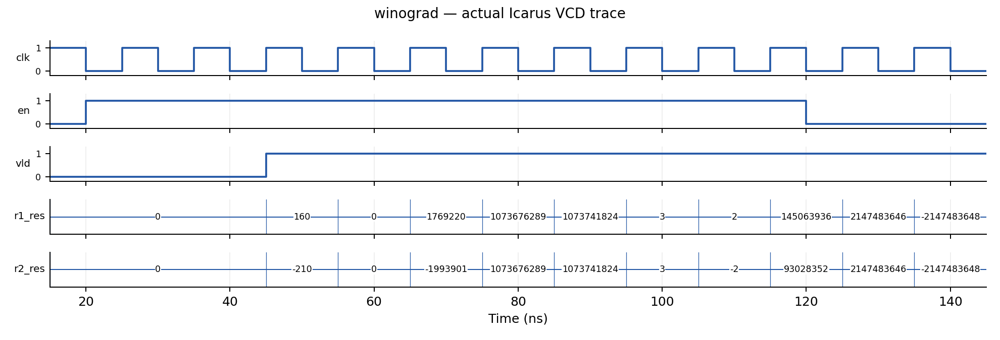
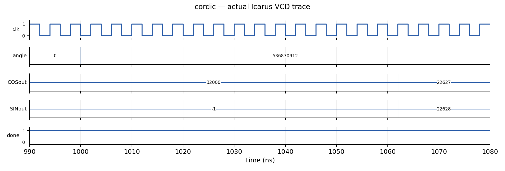
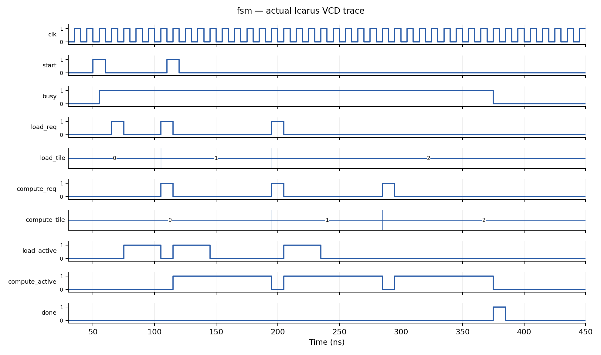

# 实验范围与完成情况

本报告依据课程《AI-Aided Digital System and Architecture Design》Fall 2026 的 Lab 1 页面及配套文件包编写。完成三项必做任务：一维 Winograd 卷积、旋转模式 CORDIC、双缓冲加载与计算控制器，并完成 2D Winograd 选做任务。没有实现 FFT，课程 Bonus 要求任选其一。

本次使用 Codex 在云环境中生成 RTL、检查接口和定点数位宽、编写独立验证驱动，并实际运行 Icarus Verilog 12.0 仿真。课程给定 Testbench、Golden Model、测试向量及检查条件保持原样。使用其原有 `NO_FSDB` 开关关闭专用波形调用，额外的顶层波形模块导出 VCD。**本报告的测试结果来自当前云环境，尚未在课程服务器 VCS/Verdi 上复验，未进行综合或上板。**

小组编号暂用 teamxx；提交前由小组确认真实编号及成员信息。报告记录本次 AI 辅助工作，不代表尚未发生的人工复核或服务器操作。

# 1D Winograd 设计

## 接口与计算目标

顶层 `winograd_1d` 保留课程全部端口：`clk,rstn,en`、四个 32 位有符号输入 `r1_x` 至 `r4_x`、三个 32 位有符号权重 `r1_w` 至 `r3_w`、两个 32 位有符号结果和 `vld`。计算等价于：

$$y_0=d_0g_0+d_1g_1+d_2g_2,\quad y_1=d_1g_0+d_2g_1+d_3g_2.$$

结果保留数学整数和的低 32 位，以二补数解释。实现采用真正的 F(2,3) 变换域计算，将直接计算所需的 6 次乘法降为 4 次。

## 定点数与奇数权重

直接对权重变换中的分子做整数除以 2，会在奇数权重上丢失半整数信息。因此本设计将权重变换放大 2 倍，延后到输出相加后统一除以 2：

$$b=(d_0-d_2,\ d_1+d_2,\ d_2-d_1,\ d_1-d_3),$$
$$h=(2g_0,\ g_0+g_1+g_2,\ g_0-g_1+g_2,\ 2g_2),$$
$$p_i=b_i h_i,\quad y_0=(p_0+p_1+p_2)/2,\quad y_1=(p_1-p_2-p_3)/2.$$

分子在精确整数运算下必为偶数，因此输出选择第 32 至第 1 位，等价于精确除 2 后保留低 32 位。负数同样成立，不存在提前截断带来的舍入误差。

| 信号 | 有符号位宽 | 目的 |
|---|---:|---|
| 输入特征及原权重 | 32 | 保持课程接口 |
| 输入变换 b | 33 | 两个 32 位数加减前符号扩展 |
| 放大的权重变换 h | 34 | 三项加减或乘 2，不丢高位 |
| 四个乘积 p | 67 | 完整容纳 33×34 位乘法 |
| 输出求和 | 69 | 为三项加减保留余量 |
| 输出 | 32 | 取求和结果 `[32:1]` |

`input_transform.v`、`weight_transform.v`、`output_transform.v` 为组合逻辑；`winograd_1d.v` 组织三级寄存流水线。

## 时序与复位

| 沿 | 工作 | 有效位 |
|---|---|---|
| 第 1 沿 n | 接收输入，寄存输入/权重变换 | `v1 ← en` |
| 第 2 沿 n+1 | 寄存四个变换域乘积 | `v2 ← v1` |
| 第 3 沿 n+2 | 寄存输出变换结果 | `vld ← v2` |

以 25ns 接收第一组输入为例，其结果在 45ns 上升沿后有效。每拍可接收一组输入；`en=0` 形成空泡，结果总线可继续变化，只有 `vld=1` 时表示有效。低有效异步复位清除全部流水寄存器、结果和有效位，丢弃在途输入。



# CORDIC 设计

## 角度与全象限变换

顶层 `cordic` 按课程端口顺序保留 `clock,xstart,ystart,zangle,xout,yout,done`。`zangle` 按无符号 32 位圆周编码解释，一周对应 $2^{32}$；90°、180°、270° 分别为 `0x40000000`、`0x80000000`、`0xC0000000`。

当最高两位为 `01` 或 `10`，先将初始向量取反，同时角度减去 180°。其余角度直接按有符号 32 位剩余角度解释。这样进入 CORDIC 的角度位于 −90° 至 +90° 范围内，覆盖全圆，包括边界 90°、180°、270°、359°。

## 16 级旋转流水线

每一级迭代 i 使用当前剩余角度的符号确定旋转方向：

$$x_{i+1}=x_i-\sigma_i(y_i\mathbin{\ggg}i),$$
$$y_{i+1}=y_i+\sigma_i(x_i\mathbin{\ggg}i),$$
$$z_{i+1}=z_i-\sigma_i\arctan(2^{-i}).$$

其中 $\sigma_i=1$（当 $z_i\geq0$），否则为 −1；`>>>` 是算术右移。查表值将反正切角度按圆周编码四舍五入为整数常量，RTL 中不使用 real 或运行时三角函数。16 次迭代均由加减法、移位及常量构成，无乘法器。

内部 x/y 为 34 位有符号数，输入左移 16 位保留小数位，另有符号及幅度余量。输出加半个整数单位后算术右移 16 位，舍入后截取 16 位。无饱和逻辑；任意过大输入向量可能溢出，但课程规定幅度不溢出。

迭代增益约为 1.646760258。课程 TB 已将 `xstart` 设置为约 `32000/1.64676=19432`、`ystart=0`，因此模块不再重复做增益补偿，输出约为 `32000*cos(θ)` 和 `32000*sin(θ)`。

输入至输出有 16 个寄存级。输入稳定保持至少 16 个上升沿后输出稳定；课程 4ns 时钟下 70ns 后读取满足要求。可每拍接收不同向量，但 `done` 不用于输入握手。接口没有 reset/start，`done` 用初始化为零的 16 位有效移位寄存器，在填满后持续为 1，表示流水线有数据；它不是单周期任务完成脉冲。此初始化适用于本次仿真及支持寄存器初始化的 FPGA；若移植到 ASIC，应另行明确上电复位方案。



# 双缓冲 FSM 设计

## 状态组织与依赖

顶层 `double_buffer_ctrl` 保留课程全部端口、方向和位宽。采用分解式 FSM：全局 `busy`（IDLE/RUN）、加载器 `loading`（FREE/WAIT）、计算器 `computing`（FREE/WAIT），以及两个缓冲区的 `occupied` 和 `ready` 标记。`next_load` 和 `next_compute` 各为 2 位，依次取 0、1、2，完成后为 3。

缓冲区映射固定为 tile 编号最低位：tile0→buffer0、tile1→buffer1、tile2→buffer0。请求发出即占用缓冲区，加载完成才置 ready；计算结束才释放 occupied。即使加载器空闲，也不能提前将 tile2 放进仍保存 tile0 的 buffer0。

| 状态/事件 | 条件 | 动作及下一状态 |
|---|---|---|
| IDLE + start | 当前不忙 | 清计数和缓冲状态，进入 RUN |
| RUN + start | 当前忙 | 忽略 start，不重启、不排队 |
| 加载器 FREE | 尚有 tile，目标 buffer 空闲，上拍 req 已低 | 发出一拍 load_req，标记占用，进入 WAIT |
| 加载器 WAIT + load_done | 有在途加载 | 目标 buffer 置 ready，回 FREE |
| 计算器 FREE | 下一个顺序 tile 已 ready，上拍 req 已低 | 发出一拍 compute_req，进入 WAIT |
| 计算器 WAIT + compute_done | tile0 或 tile1 | 释放对应 buffer，回 FREE |
| 计算器 WAIT + compute_done | tile2 | 清 busy，产生一拍 done，进入 IDLE |
| 任意状态 + rstn=0 | 低有效异步复位 | 中止任务并清除所有输出和状态 |

组合下一状态逻辑先消费本沿完成事件，再判断可以发出的请求。因此可以在接收 tile0 加载完成后，并行安排加载 tile1 和计算 tile0；在接收 tile0 计算完成后，并行安排加载 tile2 和计算 tile1（若 tile1 已 ready）。不会为等待另一引擎而阻塞独立工作。

为满足请求必须是独立单周期脉冲的要求，上一拍请求为高时不连续发出同类请求；这只是脉冲分隔，不是对另一引擎的等待。外部 done 必须对应已发出的请求，且不得与请求同周期完成，符合课程协议。

## 关键重叠波形



图中 105ns 同时发出 tile1 的加载请求和 tile0 的计算请求；195ns 发出 tile2 的加载请求和 tile1 的计算请求。两个阶段使用不同缓冲区。约 375ns 收到最后计算完成后，done 为单周期高电平，busy 返回低电平。

# Bonus：2D Winograd

实现 F(2×2,3×3)，输入 4×4、权重 3×3、输出 2×2，顶层名为 `winograd_2d`。接口为 `clk,rstn,en,x_flat[511:0],w_flat[287:0],res_flat[127:0],vld`。沿用 1D 的第 1 沿采样、第 3 沿输出和每拍吞吐规则。

打包采用行优先顺序，第 0 个元素位于最低 32 位，即第 i 个元素对应 `[32*i +: 32]`。输入、权重和输出遵循同一约定。

使用与 1D 相同的 B、G、A 变换矩阵，先按行、再按列分离计算：

$$V=B^TdB,\quad U=(2G)w(2G)^T,\quad Y=A^T(U\odot V)A/4.$$

权重变换扩大 4 倍，输出求和后统一除 4。仅有 16 次变换域乘法，而四个输出逐个直接卷积需要 36 次乘法。输入变换 34 位、权重变换 36 位、乘积 70 位、输出求和 74 位，最终取 `[33:2]` 实现除 4 后低 32 位输出。中间结果不提前丢弃小数或有效整数位。

独立 Testbench 由脚本生成，Golden Model 使用 Python 任意精度整数直接做四个 3×3 卷积，再截取低 32 位；与 RTL 的变换算法独立。未将该 Bonus 当成已由课程基础 TB 覆盖。

# 验证结果与复现

## 2026 年 11 月 7 日复核

本轮从已有 Git 提交 `98cd5137bd0405a665b5b67dcfbb0fa6da6e9a4d` 继续工作，重新读取课程网页、交接说明和七个 RTL 文件，并重新下载官方文件包。全部十个保留的课程文件（TB、run 文件及 FSM README）的 SHA256 与最新下载内容一致。重新执行全部课程和扩展仿真，得到下表结果；本轮未修改 RTL 或课程 TB。新增 `scripts/verify_vcs.py`，用于在课程服务器的新目录中执行原始 Makefile 并检查日志，但当前无 VCS/Verdi、VPN 和 SSH 凭据，尚未实际运行服务器仿真。

## 实际结果

| 检查 | 执行范围 | 结果 |
|---|---|---|
| 课程 1D Winograd TB | 原始 10 组，零误差、vld、X/Z 检查 | 10 PASS，ALL PASS |
| 课程 CORDIC TB | 原始 10 角度，两路误差不超过 8 | 10 PASS，ALL PASS |
| 课程 FSM TB | 两组延迟、运行中复位、资源依赖/重叠等 | 3 PASS，ALL PASS |
| 扩展 1D | 2400 周期，含极值/随机/空泡/在途复位 | 1861 个有效输出逐位一致 |
| 扩展 2D | 1200 周期，同类流式边界检查 | 928 个有效输出逐位一致 |
| 扩展 CORDIC | 1440 个全圆角度 + 128 个随机向量 | 1568 通过，最大绝对误差 1 |
| 扩展 FSM | 6×6 延迟组合 + 运行中复位 | 全部通过 |

扩展测试固定随机种子 `20261101`。1D/2D 对输入与权重随机穿插 0、±1、最大正数、最小负数，同时每 211 周期注入复位，以覆盖有符号运算、溢出低位、奇数权重及在途取消。有效位独立延迟两拍比较，无效输出不作数据有效性要求，复位要求结果清零。

CORDIC 的补充参考使用实际输入向量与角度编码计算理想旋转，乘以 16 级理论增益；最大误差 1 指补充测试参考。课程 TB 仍单独使用原先 `32000*$cos/$sin` 参考，未替换其幅度或容差。FSM 扩展只增加驱动调用次数，不删减公开 scoreboard 断言。

原始日志摘录：

```text
ALL PASS: Winograd, 10 cases
ALL PASS: CORDIC, 10 cases
ALL PASS
ALL PASS: 1D streaming 2400 cycles, 1861 checked outputs
ALL PASS: 2D streaming 1200 cycles, 928 checked outputs
ALL PASS: CORDIC 1568 vectors, max absolute error 1
ALL PASS: FSM 36 latency pairs and active reset
```

课程 TB 中任意 fatal、输出错误、缺失 PASS 或缺失 ALL PASS 均会使本地验证脚本失败；不是仅根据编译成功或仿真进程退出判定通过。

## 复现步骤

在仓库根目录执行：

```sh
bash scripts/setup_iverilog.sh
python3 scripts/verify.py
python3 scripts/extended.py
python3 scripts/plot_waves.py
bash scripts/setup_report.sh
python3 scripts/package.py --team teamxx
```

工具安装采用 Debian 官方 HTTPS 软件包与官方索引 SHA256 校验，解压到 checkout 之外的 `/workspace/tools/iverilog`。保留 TLS 与文件校验。仿真脚本保存编译日志、运行日志、VCD；课程 TB 的 FSDB 条件编译关闭方式由原文件支持。编译存在无显式 timescale 的警告；RTL 不含延迟语句，不影响本次功能检查，不据此声称综合时序满足目标。

# AI 生成、设计决策与审核过程

上一轮（2026 年 11 月 1 日，按仓库交接记录）从课程空壳接口开始，由 Codex 阅读作业网页、运行 Makefile 和全部公开 TB，归纳必须保持的模块名、端口、采样时序、精度及资源约束。随后生成 RTL，并在本机执行测试，根据实际结果决定后续验证范围。

关键设计决策包括：将 1D 权重变换扩大 2 倍，避免奇数权重提前右移；显式扩展有符号位宽；将三沿有效位与数据流水对齐；CORDIC 使用全象限预处理、16 个守护小数位和编译期常量表；FSM 分解独立引擎状态并记录缓冲区整个生命周期，而不是把加载与计算串行为单一顺序流程。

三项初次课程 TB 均通过后，又由 AI 生成独立直接卷积参考、全圆角度扫描和扩展 FSM 驱动，检验公开样例外的输入。此后实现 2D Winograd Bonus，并用独立二维卷积参考验证。最后读取真实 VCD 绘图，整理中文报告和严格限定内容的提交包。没有通过改写 Golden Model、减少检查或放宽容差来获得通过；没有声称发生未执行的修复或人工参与。

小组提交前应逐段审核实现，理解变换域倍增、非阻塞赋值的流水时序、有符号扩展及双缓冲依赖，并补充自身实际 AI 使用与审核记录。

# 交付范围及尚待完成事项

提交 ZIP 只含本 PDF 与七个实现 `.v` 文件：1D 四个、CORDIC 一个、FSM 一个、2D Bonus 一个；按任务目录组织。课程 TB、run、仿真输出和脚本仅留仓库复查，不打包提交。

尚待提交人完成：确认并替换真实小组编号及成员信息；在课程 VCS/Verdi 环境复验并补充证据（若课程要求专用波形）；人工检查 PDF；由组长上传课程网。当前未提交任何文件到课程网。

服务器内网网络条件尚不具备，因此尚无服务器复验结果。详细连接信息、环境要求、原课程 `make rerun` 命令和排障边界写在仓库 `docs/交接说明.md`。私钥及其他凭据未写入交付物。

# 资料来源

- 课程 Lab 1：[https://aiarchpku.com/2026Fall/project/la1.html](https://aiarchpku.com/2026Fall/project/la1.html)
- 课程文件包：[https://aiarchpku.com/2026Fall/project/lab1_files.zip](https://aiarchpku.com/2026Fall/project/lab1_files.zip)
- 公开 FSM TB：[课程下载地址](https://aiarchpku.com/2026Fall/project/fsm/src/double_buffer_ctrl_tb.sv)

本次以下载包内原始 TB 为实际运行依据，检查公开网页与文件包中的接口一致性。作业政策或时间如有更新，以课程最新通知为准。
