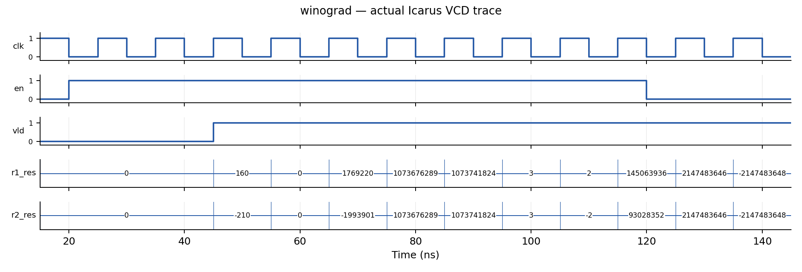
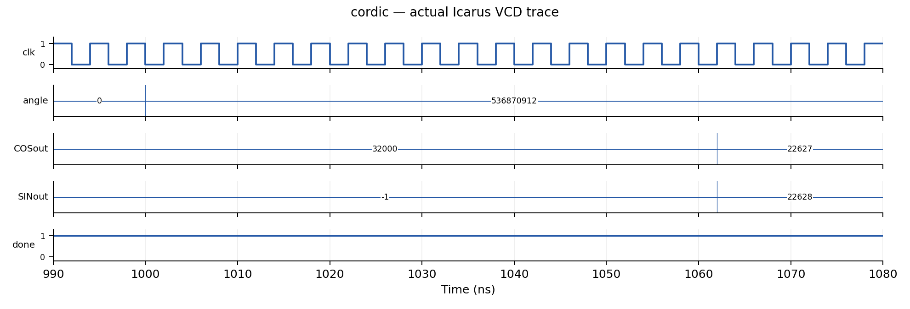
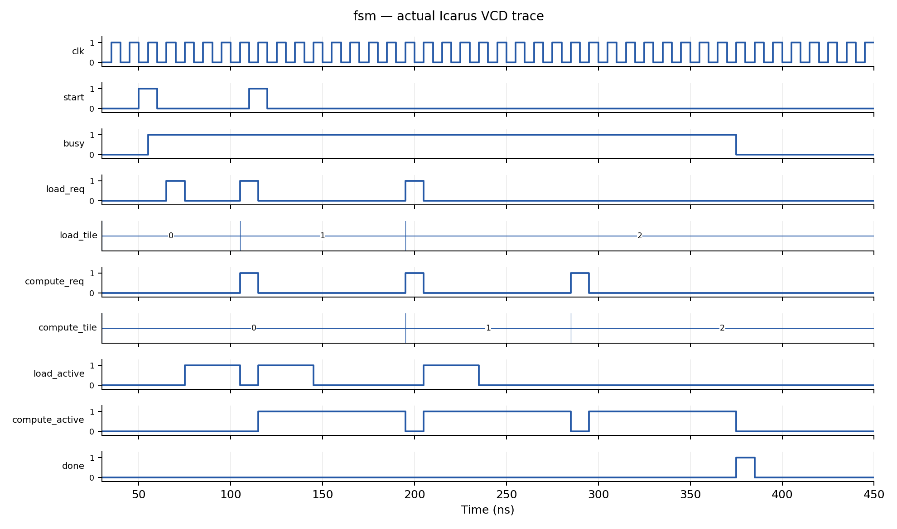

# 实验概述

本实验完成一维 Winograd 卷积单元、旋转模式 CORDIC、双缓冲加载与计算控制器，并将 Winograd 扩展为二维 F(2×2,3×3) 卷积单元。设计重点是减少乘法运算、合理安排流水线，以及保证加载和计算之间的数据依赖。

1D Winograd 用四次乘法计算两个相邻卷积点；CORDIC 通过十六级移位加减完成向量旋转；双缓冲控制器利用两个缓冲区实现加载与计算重叠；2D Winograd 用十六次乘法生成一个 2×2 输出块。各模块保持课程规定的顶层接口。

验证采用课程 Testbench 与独立扩展测试相结合的方法。课程 TB、Makefile 和文件列表保持原样。扩展测试使用直接卷积、浮点旋转参考及多组加载/计算延迟，检查算术结果、流水时序和缓冲区使用。三项课程测试在 VCS 上全部通过，2D 扩展测试在服务器上完成 1200 周期仿真，928 组有效输出均与参考结果一致。

# 1D Winograd 卷积单元

## 接口与计算目标

顶层 `winograd_1d` 保留课程全部端口：`clk,rstn,en`、四个 32 位有符号输入 `r1_x` 至 `r4_x`、三个 32 位有符号权重 `r1_w` 至 `r3_w`、两个 32 位有符号结果和 `vld`。计算等价于：

$$y_0=d_0g_0+d_1g_1+d_2g_2,\quad y_1=d_1g_0+d_2g_1+d_3g_2.$$

结果保留数学整数和的低 32 位，以二补数解释。实现采用 F(2,3) 变换域计算，将直接计算所需的 6 次乘法降为 4 次。

## 定点数与奇数权重

直接对权重变换中的分子做整数除以 2，会在奇数权重上丢失半整数信息。因此本设计将权重变换放大 2 倍，延后到输出相加后统一除以 2：

$$b=(d_0-d_2,\ d_1+d_2,\ d_2-d_1,\ d_1-d_3),$$
$$h=(2g_0,\ g_0+g_1+g_2,\ g_0-g_1+g_2,\ 2g_2),$$
$$p_i=b_i h_i,\quad y_0=(p_0+p_1+p_2)/2,\quad y_1=(p_1-p_2-p_3)/2.$$

分子在精确整数运算下必为偶数，因此输出选择第 32 至第 1 位，等价于精确除 2 后保留低 32 位。负数同样成立，不存在提前截断带来的舍入误差。

| 信号 | 有符号位宽 | 目的 |
|---|---:|---|
| 输入特征及原权重 | 32 | 保持课程接口 |
| 输入变换 b | 33 | 两个 32 位数加减前符号扩展 |
| 放大的权重变换 h | 34 | 三项加减或乘 2，不丢高位 |
| 四个乘积 p | 67 | 完整容纳 33×34 位乘法 |
| 输出求和 | 69 | 为三项加减保留余量 |
| 输出 | 32 | 取求和结果 `[32:1]` |

`input_transform.v`、`weight_transform.v`、`output_transform.v` 为组合逻辑；`winograd_1d.v` 组织三级寄存流水线。

## 时序与复位

| 沿 | 工作 | 有效位 |
|---|---|---|
| 第 1 沿 n | 接收输入，寄存输入/权重变换 | `v1 ← en` |
| 第 2 沿 n+1 | 寄存四个变换域乘积 | `v2 ← v1` |
| 第 3 沿 n+2 | 寄存输出变换结果 | `vld ← v2` |

以 25ns 接收第一组输入为例，其结果在 45ns 上升沿后有效。每拍可接收一组输入；`en=0` 形成空泡，结果总线可继续变化，只有 `vld=1` 时表示有效。低有效异步复位清除全部流水寄存器、结果和有效位，丢弃在途输入。



## 运算等价性与位宽分析

将前述变换代入第一路输出分子：

$$2(d_0-d_2)g_0+(d_1+d_2)(g_0+g_1+g_2)+(d_2-d_1)(g_0-g_1+g_2)$$
$$=2(d_0g_0+d_1g_1+d_2g_2).$$

第二路同理得到 $2(d_1g_0+d_2g_1+d_3g_2)$。因此，输出统一除 2 可精确恢复直接卷积结果。计算采用题目规定的滑动点积形式，权重顺序与输入窗口一致。

输入差和最多需要 33 位；三个 32 位权重相加或相减需要 34 位；33×34 位乘法用 67 位保存，输出求和用 69 位。符号扩展在运算之前完成。最终取 [32:1]，等于精确除 2 后取低 32 位。中间不发生会影响该结果的截断。

# CORDIC 设计

## 角度与全象限变换

顶层 `cordic` 按课程端口顺序保留 `clock,xstart,ystart,zangle,xout,yout,done`。`zangle` 按无符号 32 位圆周编码解释，一周对应 $2^{32}$；90°、180°、270° 分别为 `0x40000000`、`0x80000000`、`0xC0000000`。

当最高两位为 `01` 或 `10`，先将初始向量取反，同时角度减去 180°。其余角度直接按有符号 32 位剩余角度解释。这样进入 CORDIC 的角度位于 −90° 至 +90° 范围内，覆盖全圆，包括边界 90°、180°、270°、359°。

## 16 级旋转流水线

每一级迭代 i 使用当前剩余角度的符号确定旋转方向：

$$x_{i+1}=x_i-\sigma_i(y_i\mathbin{\ggg}i),$$
$$y_{i+1}=y_i+\sigma_i(x_i\mathbin{\ggg}i),$$
$$z_{i+1}=z_i-\sigma_i\arctan(2^{-i}).$$

其中 $\sigma_i=1$（当 $z_i\geq0$），否则为 −1；`>>>` 是算术右移。查表值将反正切角度按圆周编码四舍五入为整数常量，RTL 中不使用 real 或运行时三角函数。16 次迭代均由加减法、移位及常量构成，无乘法器。

内部 x/y 为 34 位有符号数，输入左移 16 位保留小数位，另有符号及幅度余量。输出加半个整数单位后算术右移 16 位，舍入后截取 16 位。无饱和逻辑；任意过大输入向量可能溢出，但课程规定幅度不溢出。

迭代增益约为 1.646760258。课程 TB 已将 `xstart` 设置为约 `32000/1.64676=19432`、`ystart=0`，因此模块不再重复做增益补偿，输出约为 `32000*cos(θ)` 和 `32000*sin(θ)`。

输入至输出有 16 个寄存级。输入稳定保持至少 16 个上升沿后输出稳定；课程 4ns 时钟下 70ns 后读取满足要求。可每拍接收不同向量，但 `done` 不用于输入握手。接口没有 reset/start，`done` 用初始化为零的 16 位有效移位寄存器，在填满后持续为 1，表示流水线有数据；它不是单周期任务完成脉冲。此初始化适用于本次仿真及支持寄存器初始化的 FPGA；



## 收敛范围与误差分析

象限预处理将角度映射到 −90° 至 +90°，落入旋转模式收敛区间；向量取反配合角度减 180° 保持最终旋转一致。16 级增益 $K=\prod_{i=0}^{15}\sqrt{1+2^{-2i}}\approx1.646760258$，课程输入已按该增益预补偿。

末级角度步长约为 $\arctan(2^{-15})\approx3.05\times10^{-5}$ 弧度，对 32000 幅度的坐标影响约为一个整数单位量级，另有角度表量化、移位截断和最终舍入误差。课程要求两路输出的绝对误差均不超过 8，独立扩展测试实测最大误差为 1。

34 位内部表示含 16 位小数，对 16 位输入经 CORDIC 增益后的内部坐标留有幅度余量。最终 16 位端口无饱和功能，任意大初始向量可能输出回绕；课程规定的输入幅度处于有效范围。接口没有 reset/start，done 用于指示流水线已经填满。

# 双缓冲 FSM 设计

## 状态组织与依赖

顶层 `double_buffer_ctrl` 保留课程全部端口、方向和位宽。采用分解式 FSM：全局 `busy`（IDLE/RUN）、加载器 `loading`（FREE/WAIT）、计算器 `computing`（FREE/WAIT），以及两个缓冲区的 `occupied` 和 `ready` 标记。`next_load` 和 `next_compute` 各为 2 位，依次取 0、1、2，完成后为 3。

缓冲区映射固定为 tile 编号最低位：tile0→buffer0、tile1→buffer1、tile2→buffer0。请求发出即占用缓冲区，加载完成才置 ready；计算结束才释放 occupied。即使加载器空闲，也不能提前将 tile2 放进仍保存 tile0 的 buffer0。

| 状态/事件 | 条件 | 动作及下一状态 |
|---|---|---|
| IDLE + start | 当前不忙 | 清计数和缓冲状态，进入 RUN |
| RUN + start | 当前忙 | 忽略 start，不重启、不排队 |
| 加载器 FREE | 尚有 tile，目标 buffer 空闲，上拍 req 已低 | 发出一拍 load_req，标记占用，进入 WAIT |
| 加载器 WAIT + load_done | 有在途加载 | 目标 buffer 置 ready，回 FREE |
| 计算器 FREE | 下一个顺序 tile 已 ready，上拍 req 已低 | 发出一拍 compute_req，进入 WAIT |
| 计算器 WAIT + compute_done | tile0 或 tile1 | 释放对应 buffer，回 FREE |
| 计算器 WAIT + compute_done | tile2 | 清 busy，产生一拍 done，进入 IDLE |
| 任意状态 + rstn=0 | 低有效异步复位 | 中止任务并清除所有输出和状态 |

组合下一状态逻辑先消费本沿完成事件，再判断可以发出的请求。因此可以在接收 tile0 加载完成后，并行安排加载 tile1 和计算 tile0；在接收 tile0 计算完成后，并行安排加载 tile2 和计算 tile1（若 tile1 已 ready）。不会为等待另一引擎而阻塞独立工作。

为满足请求必须是独立单周期脉冲的要求，上一拍请求为高时不连续发出同类请求；这只是脉冲分隔，不是对另一引擎的等待。外部 done 必须对应已发出的请求，且不得与请求同周期完成，符合课程协议。

## 关键重叠波形



图中 105ns 同时发出 tile1 的加载请求和 tile0 的计算请求；195ns 发出 tile2 的加载请求和 tile1 的计算请求。两个阶段使用不同缓冲区。约 375ns 收到最后计算完成后，done 为单周期高电平，busy 返回低电平。

## 状态约束与任务完成条件

正确性可按时钟沿归纳理解：复位时两个 buffer 均空闲；只有空闲目标 buffer 才允许加载，请求发出立即占用；只有加载完成才设 ready；计算请求只选择 next_compute 指定的 ready buffer；仅计算完成才释放占用。因此从初始状态出发，不会对未加载 tile 发计算请求，也不会覆盖未计算完的数据。

next_load、next_compute 单调从 0 走到 3，每次请求只增加一次，保证每个 tile 一次加载、一次计算，计算顺序固定。两个引擎的在途标志防止同一引擎同时接受两个任务。tile2 的 buffer0 复用受 occupied 限制。只有 tile2 的计算完成才产生一拍 done，busy 期间忽略 start，复位丢弃在途任务。

控制器遵循课程握手协议：完成脉冲对应已发出的请求，且晚于请求周期。在加载器和计算器均正常返回完成信号的条件下，三个 tile 依次完成，控制器回到空闲状态。

# 2D Winograd 卷积单元（Bonus）

实现 F(2×2,3×3)，输入 4×4、权重 3×3、输出 2×2，顶层名为 `winograd_2d`。接口为 `clk`、`rstn`、`en`、`x_flat[511:0]`、`w_flat[287:0]`、`res_flat[127:0]`、`vld`。沿用 1D 的第 1 沿采样、第 3 沿输出和每拍吞吐规则。

打包采用行优先顺序，第 0 个元素位于最低 32 位，即第 i 个元素对应 `[32*i +: 32]`。输入、权重和输出遵循同一约定。

使用与 1D 相同的 B、G、A 变换矩阵，先按行、再按列分离计算：

$$V=B^TdB,\quad U=(2G)w(2G)^T,\quad Y=A^T(U\odot V)A/4.$$

权重变换扩大 4 倍，输出求和后统一除 4。仅有 16 次变换域乘法，而四个输出逐个直接卷积需要 36 次乘法。输入变换 34 位、权重变换 36 位、乘积 70 位、输出求和 74 位，最终取 `[33:2]` 实现除 4 后低 32 位输出。中间结果不提前丢弃小数或有效整数位。

独立 Testbench 由脚本生成，Golden Model 使用 Python 任意精度整数直接做四个 3×3 卷积，再截取低 32 位；与 RTL 的变换算法独立。


## 二维变换的等价性

一维恒等式分别作用于行和列，即得到 $A^T[(GwG^T)\odot(B^TdB)]A$。实现将两次权重变换各扩大 2 倍，因此整体扩大 4 倍；最后统一除 4。精确整数运算下每个输出分子均是对应直接卷积和的 4 倍。

输入二维变换最多为四个原数的带符号和，34 位足够。权重变换的最大绝对系数和为 9，36 位足够容纳完整 32 位输入范围；34×36 位乘积保存为 70 位，输出中最多九项乘积组合用 74 位留出余量。最终 [33:2] 等于除 4 后取低 32 位。乘以常数 2 的表达式可化为移位，不计为一般数据乘法器。

行优先打包且元素 0 在最低 32 位是本实现明确使用的约定；测试采用同一约定。各输入矩阵及输出矩阵均采用这一打包约定。

# 运算效率与硬件开销

| 项目 | 运算量或资源结构 | 延迟与吞吐 |
|---|---|---|
| 1D | 4 次一般乘法，直接算法为 6 次，减少约 33.3% | 第 1 沿采样、第 3 沿输出；可每拍接收一组 |
| 2D | 16 次一般乘法，直接算法为 36 次，减少约 55.6% | 同样三级流水；每拍可产生一个 2×2 块 |
| CORDIC | 16 级展开，每级坐标加减和角度加减，移位量为常数 | 每组经过 16 个寄存级；结构可每拍接收一组 |
| FSM | 少量状态、计数器和两个 buffer 的占用/就绪位 | 不同 buffer 的加载与计算可以重叠 |

Winograd 的第 1 沿为采样沿，结果在两周期后的第 3 沿输出。CORDIC 采用逐级寄存结构，具备每周期接收一组输入的结构条件；本次测试按课程要求保持输入稳定，检查十六级迭代后的结果。

Winograd 通过增加变换加减法来减少乘法次数。为覆盖完整的 32 位输入范围，本实现使用较宽的乘法器和流水寄存器，硬件开销由乘法、变换逻辑和寄存器共同构成。特别是 2D 行列组合变换集中在寄存级之间，可能形成较长加法链。CORDIC 的展开结构用更多硬件换吞吐；复用单个迭代单元会省资源但降低吞吐。

若忽略控制开销，加载时长为 L、计算时长为 C，三个 tile 完全串行为 $3(L+C)$；理想重叠可接近 $L+C+2\max(L,C)$。当 L=C 时，由 6L 降到约 4L，理想加速约 1.5 倍。实际执行时间还包含请求/完成采样及脉冲间隔产生的控制开销。

本节以算法运算量、流水级数和控制重叠分析效率；具体面积、时钟频率和功耗需通过综合与实现工具进一步测量。

# 验证方案

## 课程 Testbench

1D 的 10 组测试使用直接卷积 Golden Model，检查低 32 位结果、有效位和 X/Z，要求零误差。CORDIC 的 10 个角度为 45°、15°、30°、60°、75°、90°、180°、270°、359°、57°，参考为 32000*cos/sin，两个输出各允许误差 8，含 X/Z 判失败。FSM 三项分别覆盖加载较快、计算较快和任务中复位，并检查 tile 顺序、缓冲区复用、资源占用、重叠和忙碌时 start。

每次比较满足数值及控制条件后，TB 输出 PASS；全部用例通过后输出 ALL PASS。

## 自编 1D/2D 流水测试

脚本 scripts/extended.py 使用固定种子 20261101。每个元素有 35% 概率从 0、1、−1、最大正数和最小负数中选取，其余取随机 32 位数并按有符号解释。1D 共 2400 周期，2D 共 1200 周期；独立随机 en 约 80% 有效，形成连续输入与空泡。每 211 周期安排两周期低复位，末尾四周期停止输入以排空流水线。

Python 任意精度整数计算普通直接卷积，最后逐输出保留低 32 位；参考算法不使用 RTL 的 Winograd 变换，从而避免参考模型与被测设计共享同一变换错误。2D 计算四个窗口，各九项乘积相加，权重不翻转，然后以低位优先行主序打包。

TB 在下降沿读向量并设置输入，在上升沿将 en 和参考结果移入独立队列，等待 1ns 后比较。vld 每周期必须等于延迟后的 a2；vld 有效时 y 必须与 q2 逐位相等。复位时有效队列、参考队列清零，并要求输出清零。使用 !== 能将有效结果中的 X/Z 判为失败。无效周期不检查无意义的结果数据。

| 风险 | 用例与检查 | 为什么需要 |
|---|---|---|
| 有符号扩展错误 | 正负随机值、极值，逐位比较 | 暴露中间位宽和 signed 传播问题 |
| 奇数权重提前除法 | 随机奇数权重，直接卷积参考 | 发现半整数信息过早丢失 |
| 高位溢出处理错误 | 极值及大幅随机数，低 32 位比较 | 验证回绕而非饱和行为 |
| 行列或打包顺序错误 | 非对称随机矩阵及四个输出整体比较 | 避免对称样例掩盖转置错误 |
| 数据/有效位错拍 | 连续输入、空泡、独立队列 | 检查吞吐及第 3 沿对应关系 |
| 在途复位失效 | 周期性复位、清空参考队列 | 发现旧结果在复位后泄出 |
| 最后几组漏检 | 停止输入并排空流水线 | 覆盖尾部仍在处理的输入 |

1D 实测 1861 组有效输出全部一致；2D 实测 928 组有效输出全部一致，即比较了 3712 个 32 位卷积结果。每组包含四个输出；1200 周期包括有效输入、复位、空泡和末尾排空。

上述用例分别针对算术精度、矩阵索引、流水线对齐及复位行为。算法等价推导给出计算依据，位宽分析保证中间结果完整，独立参考比较则检查 RTL 对这些规则的落实情况，形成从算法到实现的验证过程。

## 自编 CORDIC 与 FSM 扩展测试

CORDIC 对全圆每隔 0.25° 扫描，共 1440 个角度，另加 128 组随机角度和安全范围内的正负初始向量（包含非零 y）。共 1568 组。参考以实际角度编码和输入向量计算理想旋转，乘以 16 级理论增益；每组保持 16 个上升沿后检查两路误差、X/Z 和 done。最大误差为 1。这与课程 TB 固定 32000 幅度参考不同，二者分别运行，未替换课程参考或放宽容差。

FSM 扩展使用加载/计算延迟集合 {1,2,3,5,8,13} 的笛卡尔积，共 36 组，并运行任务中复位。延迟从很短到较长，包含两者相等、加载快和计算快三种关系，复用原课程 scoreboard 的全部断言。这些组合覆盖了两类引擎相互等待和并行工作的典型情况。


# 仿真结果与分析

## 验证环境与结果汇总

课程服务器使用 VCS Q-2020.03-SP2-7 Full64，波形通过 Verdi 查看，FSDB Dumper 版本为 Verdi-R-2020.12-SP1。本地扩展验证使用 Icarus Verilog 12.0。服务器结果依据终端运行记录及 Verdi 截图整理；本地结果依据仿真日志统计。FSM 于 2026 年 11 月 8 日在独立目录中完成复验，采用不启用 `-debug_access+r` 的 VCS 配置。此次编译日志未出现段错误，运行结果为三项 PASS 和 ALL PASS；RTL 与课程 TB 保持原验证版本。

| 测试项目 | 环境 | 结果 |
|---|---|---|
| 1D Winograd 课程 TB | VCS | 10/10 通过，误差为 0 |
| CORDIC 课程 TB | VCS | 10/10 通过，截图中最大绝对误差为 1 |
| FSM 课程 TB | VCS（不启用调试访问） | 两组延迟和运行中复位均通过 |
| 1D 扩展测试 | Icarus | 2400 周期，1861 组有效输出全部一致 |
| 2D 扩展测试 | VCS、Icarus | 1200 周期，928 组有效输出全部一致 |
| CORDIC 扩展测试 | Icarus | 1568 组向量通过，最大绝对误差为 1 |
| FSM 扩展测试 | Icarus | 36 组延迟组合和运行中复位均通过 |

三项课程测试的服务器汇总为：

```text
winograd: 10 PASS; ALL PASS
cordic: 10 PASS; ALL PASS
fsm: 3 PASS; ALL PASS
```

\serverfigure{server-summary.png}{三项课程测试的服务器运行结果。}

## 1D Winograd：结果与有效位对齐

第一组输入在 25ns 被采样，45ns 上升沿后输出为 160 和 −210，TB 在 46ns 完成比较。这一过程符合“第 1 沿采样、第 3 沿输出”的时序要求。随后连续十组结果按顺序输出；en 在 120ns 降低后，流水线继续输出在途结果，直到最后一组完成后 vld 才变低。

Verdi 中 passed 最终显示十六进制 a，即十进制 10，failed 保持 0。第一组 r1_res=0xa0 对应 160，r2_res=0xffffff2e 按二补数解释为 −210。边界用例的输出包括 2147483646 和 −2147483648，与 Golden Model 的低 32 位结果一致。数值比较和有效位检查共同验证了整数计算及流水线对齐。

\serverfigure{server-winograd-log.png}{1D Winograd 课程测试结果。}
\serverfigure{server-winograd-wave.png}{1D Winograd 的服务器 Verdi 波形。}

## CORDIC：全象限旋转结果

课程测试覆盖第一象限内的多个角度，以及 90°、180°、270° 和接近一周的 359°。代表性结果如下：

| 角度 | 参考值 (cos, sin) | 输出 (xout, yout) | 两路绝对误差 |
|---|---|---|---|
| 45° | (22627, 22627) | (22627, 22628) | (0, 1) |
| 90° | (0, 32000) | (1, 32000) | (1, 0) |
| 180° | (−32000, 0) | (−32000, 1) | (0, 1) |
| 270° | (0, −32000) | (−1, −32000) | (1, 0) |
| 359° | (31995, −558) | (31995, −559) | (0, 1) |

Verdi 波形中 Xin=0x4be8，即 19432，Yin=0；角度编码依次变化，输出经过流水线延迟后稳定。输出 0x8300 按有符号 16 位解释为 −32000。done 在流水线填满后持续为高，passed 最终为 10，failed 为 0。全圆扫描及非零初始 y 的扩展测试进一步检验了象限预处理与二维向量旋转，最大绝对误差为 1，满足课程允许误差 8 的要求。

\serverfigure{server-cordic-log.png}{CORDIC 课程角度测试结果。}
\serverfigure{server-cordic-wave.png}{CORDIC 的服务器 Verdi 波形。}

## 双缓冲 FSM：依赖关系与重叠执行

独立目录复验的课程 TB 分别运行加载延迟 3、计算延迟 8，以及加载延迟 8、计算延迟 3 两组时序，并检查运行中复位，三项均通过。仿真在 980000ps（980ns）结束，输出 ALL PASS。前者使加载器较早完成、等待计算释放缓冲区；后者使计算器较早完成、等待后续数据加载。两种情况下，tile 的计算顺序和 buffer0 的复用条件均满足要求。

本地波形显示，105ns 同时发出 tile1 的加载请求与 tile0 的计算请求；195ns 同时安排 tile2 加载和 tile1 计算。每一对操作使用不同缓冲区，说明独立阶段能够重叠执行。忙碌期间重复 start 未触发任务重启，最终 done 为单周期脉冲。36 组延迟组合进一步验证了不同等待关系下的控制行为。

\serverfigure{server-fsm-recheck.png}{FSM 不启用调试访问时的编译与功能复验记录。}

## 2D Winograd：四个输出的逐位比较

服务器运行 stream2.sv 和 winograd_2d.v，最终输出：

```text
ALL PASS: 2D streaming 1200 cycles, 928 checked outputs
```

928 组有效输出对应 3712 个 32 位卷积结果，均与 Python 直接卷积参考逐位一致。每周期的 vld 和复位检查也全部通过，说明二维行列变换、打包顺序、最终截断及三级流水线在这些测试中保持一致。

仿真结束时间为 12006000ps，即 12006ns，与 10ns 时钟下的 1200 次测试循环及启动、比较偏移相符。该时间表示整段测试激励的长度；模块仍按第 3 沿输出并支持连续输入。终端中的 CPU Time 1.160 seconds 则表示仿真器执行这段测试所用的服务器时间。

\serverfigure{server-bonus-log.png}{2D Winograd 扩展测试的服务器运行结果。}

# AI 辅助设计与验证过程

实验借助 Codex 完成 RTL 初稿、定点位宽分析和扩展测试脚本。设计首先从课程接口和 Testbench 提取约束：Winograd 的三沿输出时序与低 32 位结果、CORDIC 的角度编码与误差要求，以及 FSM 的缓冲区依赖和单周期请求。

实现过程中，1D 权重变换采用整体放大两倍、输出统一除二的方法，解决奇数权重的精度问题；2D 将同一方法扩展到行列两次变换。CORDIC 使用象限预处理与小数保护位控制误差。FSM 将加载器、计算器及缓冲区占用状态分开记录，以便在完成事件到来后及时安排下一步操作。

课程测试通过后，增加独立直接卷积参考、全圆角度扫描和多组 FSM 延迟测试。随后在课程服务器执行 VCS 仿真并用 Verdi 检查波形。设计审查重点包括符号扩展、乘积与累加位宽、有效位延迟以及缓冲区释放条件，报告据此整理实现原理与测试结果。

# 实验结论

本实验完成三个必做模块和 2D Winograd 扩展。1D 与 2D Winograd 分别将一般乘法次数从 6 次减少到 4 次、从 36 次减少到 16 次，并通过延后缩放和完整中间位宽保持整数结果正确。CORDIC 采用十六级移位加减流水线完成全象限旋转，测试误差满足课程要求。双缓冲控制器正确维护加载、计算与缓冲区释放关系，实现了独立阶段的重叠执行。

课程 Testbench 和扩展测试全部通过。代数推导、位宽分析、控制状态约束与独立参考比较相结合，为算术功能和接口时序提供了验证依据。

# 问题分析与改进方向

## 硬件实现优化

当前设计优先保证完整输入范围的计算精度，使用了较宽的中间数据通路。下一步可通过综合评估乘法器、寄存器和变换加法链的面积与时序，再根据目标频率调整流水分级。CORDIC 如需移植到 ASIC，还需补充明确的上电复位方案；如面向超出课程幅度的输入，可进一步考虑输出饱和策略。

## 验证覆盖扩展

现有验证采用代数分析和定向、随机仿真。后续可增加 Winograd 的异步复位即时检查、CORDIC 逐周期变化输入的流水比较，以及 FSM 每个 tile 使用不同随机延迟的测试。形式属性可用于进一步检查 valid 对齐、buffer 互斥和请求顺序。

# 参考资料

- 《AI-Aided Digital System and Architecture Design》Fall 2026，Lab 1 作业说明：<https://aiarchpku.com/2026Fall/project/la1.html>。
- 课程 Lab 1 运行文件与 Testbench：<https://aiarchpku.com/2026Fall/project/lab1_files.zip>。
- 本实验 RTL、扩展测试脚本、Icarus 仿真日志及服务器 VCS/Verdi 验证记录。
