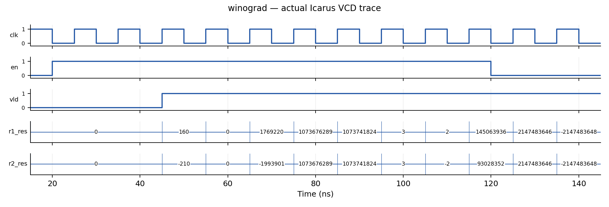
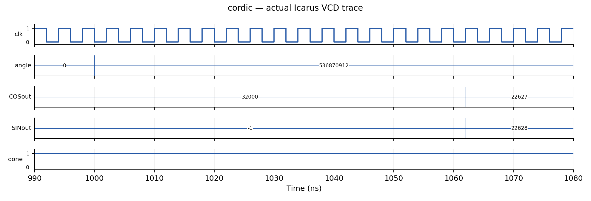
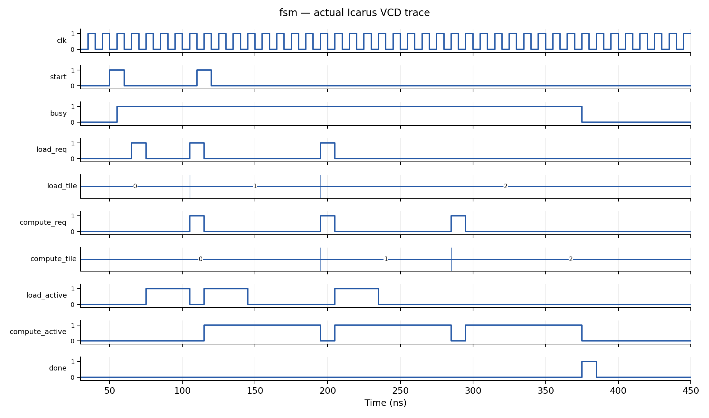

# 报告范围与证据说明

本实验完成 1D Winograd、CORDIC、双缓冲 FSM 三项必做任务，以及 2D Winograd Bonus。组号为 team01；本公开版本不列成员姓名、学号、服务器账号或主机名。成员信息由提交人在本地补充。本文为独立新版，不覆盖此前报告，也不改变 RTL。

三个课程原始 Testbench、Makefile、文件列表及 FSM README 已与官方下载包逐字节核对一致。顶层实现文件并非“原样未改”：官方 Winograd/CORDIC 顶层为空，FSM 顶层只有接口及占位逻辑，均需要编写实现。FSM 输出从 wire 改为 reg 以支持过程赋值，端口名、方向、宽度、顺序保持要求。2D 模块及其 TB 为自行编写。扩展 FSM 测试使用独立副本，增加驱动组合而保留检查条件；不覆盖课程原始 TB。

证据分为两类：第一类是此前在云环境运行的 Icarus Verilog 12.0 测试日志和由真实 VCD 绘制的波形；第二类是用户提供的服务器 VCS/Verdi 截图。本轮已阅读七张截图，但未收到可读取的原图文件及服务器原始日志。因此下面的服务器数据是截图转录和解读，不声称已审查完整服务器日志，也不将本地波形标为服务器波形。

截图显示 VCS Q-2020.03-SP2-7 Full64；日志显示 FSDB Dumper Release Verdi-R-2020.12-SP1。截图内日期为 Nov 7 2026；服务器时区未核实，不将其钟点换算为北京时间。本文日期按用户所在时区填写。

三个必做任务的自动脚本汇总均为 ALL PASS，2D Bonus 为 1200 周期、928 组有效输出通过。FSM 单独编译截图同时包含工具子进程 Segmentation fault，必须保留此异常说明。功能比较通过与工具编译流程无异常是两个不同结论。

# 四个任务分别解决什么问题

| 任务 | 通俗说明 | 实际输出 |
|---|---|---|
| 1D Winograd | 用更少乘法算两个相邻的一维卷积点 | 两个 32 位整数 |
| CORDIC | 连续做小角度旋转，用移位加减近似正弦余弦 | 两个 16 位坐标 |
| 双缓冲 FSM | 安排加载和计算使用不同缓冲区，减少互相等待 | 请求、编号、busy、done，无实际数据通路 |
| 2D Winograd | 由 4×4 输入和 3×3 核生成 2×2 卷积块 | 四个 32 位整数 |

# 1D Winograd 设计

## 接口与计算目标

顶层 `winograd_1d` 保留课程全部端口：`clk,rstn,en`、四个 32 位有符号输入 `r1_x` 至 `r4_x`、三个 32 位有符号权重 `r1_w` 至 `r3_w`、两个 32 位有符号结果和 `vld`。计算等价于：

$$y_0=d_0g_0+d_1g_1+d_2g_2,\quad y_1=d_1g_0+d_2g_1+d_3g_2.$$

结果保留数学整数和的低 32 位，以二补数解释。实现采用真正的 F(2,3) 变换域计算，将直接计算所需的 6 次乘法降为 4 次。

## 定点数与奇数权重

直接对权重变换中的分子做整数除以 2，会在奇数权重上丢失半整数信息。因此本设计将权重变换放大 2 倍，延后到输出相加后统一除以 2：

$$b=(d_0-d_2,\ d_1+d_2,\ d_2-d_1,\ d_1-d_3),$$
$$h=(2g_0,\ g_0+g_1+g_2,\ g_0-g_1+g_2,\ 2g_2),$$
$$p_i=b_i h_i,\quad y_0=(p_0+p_1+p_2)/2,\quad y_1=(p_1-p_2-p_3)/2.$$

分子在精确整数运算下必为偶数，因此输出选择第 32 至第 1 位，等价于精确除 2 后保留低 32 位。负数同样成立，不存在提前截断带来的舍入误差。

| 信号 | 有符号位宽 | 目的 |
|---|---:|---|
| 输入特征及原权重 | 32 | 保持课程接口 |
| 输入变换 b | 33 | 两个 32 位数加减前符号扩展 |
| 放大的权重变换 h | 34 | 三项加减或乘 2，不丢高位 |
| 四个乘积 p | 67 | 完整容纳 33×34 位乘法 |
| 输出求和 | 69 | 为三项加减保留余量 |
| 输出 | 32 | 取求和结果 `[32:1]` |

`input_transform.v`、`weight_transform.v`、`output_transform.v` 为组合逻辑；`winograd_1d.v` 组织三级寄存流水线。

## 时序与复位

| 沿 | 工作 | 有效位 |
|---|---|---|
| 第 1 沿 n | 接收输入，寄存输入/权重变换 | `v1 ← en` |
| 第 2 沿 n+1 | 寄存四个变换域乘积 | `v2 ← v1` |
| 第 3 沿 n+2 | 寄存输出变换结果 | `vld ← v2` |

以 25ns 接收第一组输入为例，其结果在 45ns 上升沿后有效。每拍可接收一组输入；`en=0` 形成空泡，结果总线可继续变化，只有 `vld=1` 时表示有效。低有效异步复位清除全部流水寄存器、结果和有效位，丢弃在途输入。



# CORDIC 设计

## 角度与全象限变换

顶层 `cordic` 按课程端口顺序保留 `clock,xstart,ystart,zangle,xout,yout,done`。`zangle` 按无符号 32 位圆周编码解释，一周对应 $2^{32}$；90°、180°、270° 分别为 `0x40000000`、`0x80000000`、`0xC0000000`。

当最高两位为 `01` 或 `10`，先将初始向量取反，同时角度减去 180°。其余角度直接按有符号 32 位剩余角度解释。这样进入 CORDIC 的角度位于 −90° 至 +90° 范围内，覆盖全圆，包括边界 90°、180°、270°、359°。

## 16 级旋转流水线

每一级迭代 i 使用当前剩余角度的符号确定旋转方向：

$$x_{i+1}=x_i-\sigma_i(y_i\mathbin{\ggg}i),$$
$$y_{i+1}=y_i+\sigma_i(x_i\mathbin{\ggg}i),$$
$$z_{i+1}=z_i-\sigma_i\arctan(2^{-i}).$$

其中 $\sigma_i=1$（当 $z_i\geq0$），否则为 −1；`>>>` 是算术右移。查表值将反正切角度按圆周编码四舍五入为整数常量，RTL 中不使用 real 或运行时三角函数。16 次迭代均由加减法、移位及常量构成，无乘法器。

内部 x/y 为 34 位有符号数，输入左移 16 位保留小数位，另有符号及幅度余量。输出加半个整数单位后算术右移 16 位，舍入后截取 16 位。无饱和逻辑；任意过大输入向量可能溢出，但课程规定幅度不溢出。

迭代增益约为 1.646760258。课程 TB 已将 `xstart` 设置为约 `32000/1.64676=19432`、`ystart=0`，因此模块不再重复做增益补偿，输出约为 `32000*cos(θ)` 和 `32000*sin(θ)`。

输入至输出有 16 个寄存级。输入稳定保持至少 16 个上升沿后输出稳定；课程 4ns 时钟下 70ns 后读取满足要求。可每拍接收不同向量，但 `done` 不用于输入握手。接口没有 reset/start，`done` 用初始化为零的 16 位有效移位寄存器，在填满后持续为 1，表示流水线有数据；它不是单周期任务完成脉冲。此初始化适用于本次仿真及支持寄存器初始化的 FPGA；若移植到 ASIC，应另行明确上电复位方案。



# 双缓冲 FSM 设计

## 状态组织与依赖

顶层 `double_buffer_ctrl` 保留课程全部端口、方向和位宽。采用分解式 FSM：全局 `busy`（IDLE/RUN）、加载器 `loading`（FREE/WAIT）、计算器 `computing`（FREE/WAIT），以及两个缓冲区的 `occupied` 和 `ready` 标记。`next_load` 和 `next_compute` 各为 2 位，依次取 0、1、2，完成后为 3。

缓冲区映射固定为 tile 编号最低位：tile0→buffer0、tile1→buffer1、tile2→buffer0。请求发出即占用缓冲区，加载完成才置 ready；计算结束才释放 occupied。即使加载器空闲，也不能提前将 tile2 放进仍保存 tile0 的 buffer0。

| 状态/事件 | 条件 | 动作及下一状态 |
|---|---|---|
| IDLE + start | 当前不忙 | 清计数和缓冲状态，进入 RUN |
| RUN + start | 当前忙 | 忽略 start，不重启、不排队 |
| 加载器 FREE | 尚有 tile，目标 buffer 空闲，上拍 req 已低 | 发出一拍 load_req，标记占用，进入 WAIT |
| 加载器 WAIT + load_done | 有在途加载 | 目标 buffer 置 ready，回 FREE |
| 计算器 FREE | 下一个顺序 tile 已 ready，上拍 req 已低 | 发出一拍 compute_req，进入 WAIT |
| 计算器 WAIT + compute_done | tile0 或 tile1 | 释放对应 buffer，回 FREE |
| 计算器 WAIT + compute_done | tile2 | 清 busy，产生一拍 done，进入 IDLE |
| 任意状态 + rstn=0 | 低有效异步复位 | 中止任务并清除所有输出和状态 |

组合下一状态逻辑先消费本沿完成事件，再判断可以发出的请求。因此可以在接收 tile0 加载完成后，并行安排加载 tile1 和计算 tile0；在接收 tile0 计算完成后，并行安排加载 tile2 和计算 tile1（若 tile1 已 ready）。不会为等待另一引擎而阻塞独立工作。

为满足请求必须是独立单周期脉冲的要求，上一拍请求为高时不连续发出同类请求；这只是脉冲分隔，不是对另一引擎的等待。外部 done 必须对应已发出的请求，且不得与请求同周期完成，符合课程协议。

## 关键重叠波形



图中 105ns 同时发出 tile1 的加载请求和 tile0 的计算请求；195ns 发出 tile2 的加载请求和 tile1 的计算请求。两个阶段使用不同缓冲区。约 375ns 收到最后计算完成后，done 为单周期高电平，busy 返回低电平。

# Bonus：2D Winograd

实现 F(2×2,3×3)，输入 4×4、权重 3×3、输出 2×2，顶层名为 `winograd_2d`。接口为 `clk`、`rstn`、`en`、`x_flat[511:0]`、`w_flat[287:0]`、`res_flat[127:0]`、`vld`。沿用 1D 的第 1 沿采样、第 3 沿输出和每拍吞吐规则。

打包采用行优先顺序，第 0 个元素位于最低 32 位，即第 i 个元素对应 `[32*i +: 32]`。输入、权重和输出遵循同一约定。

使用与 1D 相同的 B、G、A 变换矩阵，先按行、再按列分离计算：

$$V=B^TdB,\quad U=(2G)w(2G)^T,\quad Y=A^T(U\odot V)A/4.$$

权重变换扩大 4 倍，输出求和后统一除 4。仅有 16 次变换域乘法，而四个输出逐个直接卷积需要 36 次乘法。输入变换 34 位、权重变换 36 位、乘积 70 位、输出求和 74 位，最终取 `[33:2]` 实现除 4 后低 32 位输出。中间结果不提前丢弃小数或有效整数位。

独立 Testbench 由脚本生成，Golden Model 使用 Python 任意精度整数直接做四个 3×3 卷积，再截取低 32 位；与 RTL 的变换算法独立。未将该 Bonus 当成已由课程基础 TB 覆盖。


# 正确性分析：算法、位宽与控制条件

## 一维变换为何与直接卷积相等

将前述变换代入第一路输出分子：

$$2(d_0-d_2)g_0+(d_1+d_2)(g_0+g_1+g_2)+(d_2-d_1)(g_0-g_1+g_2)$$
$$=2(d_0g_0+d_1g_1+d_2g_2).$$

第二路同理得到 $2(d_1g_0+d_2g_1+d_3g_2)$。因此统一除 2 是精确操作，不是近似舍入。这里按题目定义做滑动点积，不额外翻转权重。乘法次数减少依靠代数恒等式，不依靠测试向量巧合。

输入差和最多需要 33 位；三个 32 位权重相加或相减需要 34 位；33×34 位乘法用 67 位保存，输出求和用 69 位。符号扩展在运算之前完成。最终取 [32:1]，等于精确除 2 后取低 32 位。中间不发生会影响该结果的截断。

## 二维推广为何成立

一维恒等式分别作用于行和列，即得到 $A^T[(GwG^T)\odot(B^TdB)]A$。实现将两次权重变换各扩大 2 倍，因此整体扩大 4 倍；最后统一除 4。精确整数运算下每个输出分子均是对应直接卷积和的 4 倍。

输入二维变换最多为四个原数的带符号和，34 位足够。权重变换的最大绝对系数和为 9，36 位足够容纳完整 32 位输入范围；34×36 位乘积保存为 70 位，输出中最多九项乘积组合用 74 位留出余量。最终 [33:2] 等于除 4 后取低 32 位。乘以常数 2 的表达式可化为移位，不计为一般数据乘法器。

行优先打包且元素 0 在最低 32 位是本实现明确使用的约定；测试采用同一约定。课程页面没有进一步规定首元素在最高端还是最低端，报告必须保留此说明。

## CORDIC 是有误差边界的近似计算

象限预处理将角度映射到 −90° 至 +90°，落入旋转模式收敛区间；向量取反配合角度减 180° 保持最终旋转一致。16 级增益 $K=\prod_{i=0}^{15}\sqrt{1+2^{-2i}}\approx1.646760258$，课程输入已按该增益预补偿。

末级角度步长约为 $\arctan(2^{-15})\approx3.05\times10^{-5}$ 弧度，对 32000 幅度的坐标影响约为一个整数单位量级，另有角度表量化、移位截断和最终舍入误差。这是误差规模解释，不是完整的最坏情况形式证明。实际课程标准为绝对误差不超过 8；独立扩展测试实测最大误差为 1。

34 位内部表示含 16 位小数，对 16 位输入经 CORDIC 增益后的内部坐标留有幅度余量。最终 16 位端口无饱和功能，任意大初始向量可能输出回绕；课程规定的输入幅度处于有效范围。无 reset/start 的接口决定 done 是启动填满指示而非单任务握手；初始化适用于本次仿真及支持初始化的 FPGA，不构成 ASIC 上电复位设计。

## FSM 不变量与完成性

正确性可按时钟沿归纳理解：复位时两个 buffer 均空闲；只有空闲目标 buffer 才允许加载，请求发出立即占用；只有加载完成才设 ready；计算请求只选择 next_compute 指定的 ready buffer；仅计算完成才释放占用。因此从初始状态出发，不会对未加载 tile 发计算请求，也不会覆盖未计算完的数据。

next_load、next_compute 单调从 0 走到 3，每次请求只增加一次，保证每个 tile 一次加载、一次计算，计算顺序固定。两个引擎的在途标志防止同一引擎同时接受两个任务。tile2 的 buffer0 复用受 occupied 限制。只有 tile2 的计算完成才产生一拍 done，busy 期间忽略 start，复位丢弃在途任务。

该结论依赖课程协议：完成脉冲对应已经发出的请求，不与请求同周期完成，外部不会发送过期完成脉冲。最终完成还要求外部加载器和计算器最终响应；如果外部永不完成，控制器不会凭空宣告任务完成。它不实现超时、取消或错误恢复，这些不属于本题要求。

# 实现效率与实际代价

| 项目 | 运算量或资源结构 | 延迟与吞吐 |
|---|---|---|
| 1D | 4 次一般乘法，直接算法为 6 次，减少约 33.3% | 第 1 沿采样、第 3 沿输出；可每拍接收一组 |
| 2D | 16 次一般乘法，直接算法为 36 次，减少约 55.6% | 同样三级流水；每拍可产生一个 2×2 块 |
| CORDIC | 16 级展开，每级坐标加减和角度加减，移位量为常数 | 每组经过 16 个寄存级；结构可每拍接收一组 |
| FSM | 少量状态、计数器和两个 buffer 的占用/就绪位 | 不同 buffer 的加载与计算可以重叠 |

三级流水的“三沿”包含采样沿，因此不是采样后再等三个完整周期。CORDIC 每拍输入能力来自结构分析，现有扩展 TB 主要让每组保持 16 个上升沿，没有逐拍不同输入的流式 scoreboard，不能将后者标为已测。

Winograd 乘法减少不意味着面积或频率同比改善：本实现采用较宽乘法器和较多变换加法器，增加寄存器，并未专门优化面积、功耗或关键路径。特别是 2D 行列组合变换集中在寄存级之间，可能形成较长加法链。CORDIC 的展开结构用更多硬件换吞吐；复用单个迭代单元会省资源但降低吞吐。

若忽略控制开销，加载时长为 L、计算时长为 C，三个 tile 完全串行为 $3(L+C)$；理想重叠可接近 $L+C+2\max(L,C)$。当 L=C 时，由 6L 降到约 4L，理想加速约 1.5 倍。实际还有请求/完成采样与脉冲间隔，不能把这个公式当作本 RTL 的精确周期计数。

尚未做综合、布局布线、静态时序分析或上板，因此不报告实际门数、面积、最高时钟频率或功耗。截图中的 CPU time 是仿真器在服务器上的执行时间，不是硬件计算延迟或吞吐率。

# Testbench 设计、覆盖范围与结果意义

## 课程 Testbench

1D 的 10 组测试使用直接卷积 Golden Model，检查低 32 位结果、有效位和 X/Z，要求零误差。CORDIC 的 10 个角度为 45°、15°、30°、60°、75°、90°、180°、270°、359°、57°，参考为 32000*cos/sin，两个输出各允许误差 8，含 X/Z 判失败。FSM 三项分别覆盖加载较快、计算较快和任务中复位，并检查 tile 顺序、缓冲区复用、资源占用、重叠和忙碌时 start。

PASS 表示该次比较满足 TB 的全部条件；ALL PASS 表示该 TB 的所有已执行检查通过。它不意味着所有可能输入、所有延迟组合或所有硬件实现条件都已经验证。

## 自编 1D/2D 流水测试

脚本 scripts/extended.py 使用固定种子 20261101。每个元素有 35% 概率从 0、1、−1、最大正数和最小负数中选取，其余取随机 32 位数并按有符号解释。1D 共 2400 周期，2D 共 1200 周期；独立随机 en 约 80% 有效，形成连续输入与空泡。每 211 周期安排两周期低复位，末尾四周期停止输入以排空流水线。

Python 任意精度整数计算普通直接卷积，最后逐输出保留低 32 位；参考算法不使用 RTL 的 Winograd 变换，所以可发现两种变换共用同一个错误公式的风险。2D 计算四个窗口，各九项乘积相加，权重不翻转，然后以低位优先行主序打包。

TB 在下降沿读向量并设置输入，在上升沿将 en 和参考结果移入独立队列，等待 1ns 后比较。vld 每周期必须等于延迟后的 a2；vld 有效时 y 必须与 q2 逐位相等。复位时有效队列、参考队列清零，并要求输出清零。使用 !== 能将有效结果中的 X/Z 判为失败。无效周期不检查无意义的结果数据。

| 风险 | 用例与检查 | 为什么需要 |
|---|---|---|
| 有符号扩展错误 | 正负随机值、极值，逐位比较 | 暴露中间位宽和 signed 传播问题 |
| 奇数权重提前除法 | 随机奇数权重，直接卷积参考 | 发现半整数信息过早丢失 |
| 高位溢出处理错误 | 极值及大幅随机数，低 32 位比较 | 验证回绕而非饱和行为 |
| 行列或打包顺序错误 | 非对称随机矩阵及四个输出整体比较 | 避免对称样例掩盖转置错误 |
| 数据/有效位错拍 | 连续输入、空泡、独立队列 | 检查吞吐及第 3 沿对应关系 |
| 在途复位失效 | 周期性复位、清空参考队列 | 发现旧结果在复位后泄出 |
| 最后几组漏检 | 停止输入并排空流水线 | 覆盖尾部仍在处理的输入 |

1D 实测 1861 组有效输出全部一致；2D 实测 928 组有效输出全部一致，即比较了 3712 个 32 位卷积结果。928 是有效结果块数，不是只有 928 个单独标量。1200 是含复位、空泡和排空在内的测试周期数，不是硬件处理一组输入需要 1200 周期。

该随机测试不是穷举或形式验证；它也未单独断言复位下降沿至下一时钟沿之间立即清零，没有专门注入未知输入。代数等价推导和位宽分析说明算法应当成立，独立 TB 检查 RTL 是否按推导实现。二者结合构成有针对性的工程验证依据，不能写成“有限测试已证明绝无疏漏”。

## 自编 CORDIC 与 FSM 扩展测试

CORDIC 对全圆每隔 0.25° 扫描，共 1440 个角度，另加 128 组随机角度和安全范围内的正负初始向量（包含非零 y）。共 1568 组。参考以实际角度编码和输入向量计算理想旋转，乘以 16 级理论增益；每组保持 16 个上升沿后检查两路误差、X/Z 和 done。最大误差为 1。这与课程 TB 固定 32000 幅度参考不同，二者分别运行，未替换课程参考或放宽容差。

FSM 扩展使用加载/计算延迟集合 {1,2,3,5,8,13} 的笛卡尔积，共 36 组，并运行任务中复位。延迟从很短到较长，包含两者相等、加载快和计算快三种关系，复用原课程 scoreboard 的全部断言。它验证了这些确定延迟组合，不是任意逐 tile 变化延迟的随机测试，也没有验证协议外的错误完成信号。

# 用户提供的服务器截图：逐项解读

本节中的终端文字为用户截图的转录，不是重新运行产生的日志。原图文件尚待提供，插图位置由 TeX 的可选图接口保留。截图包含的账号、主机名、个人目录必须在导出像素中不可逆地裁去或遮挡后，才能作为 figures/server-*.png 放入源码包；仅用 PDF 白块覆盖并不能确保底层图像信息不被提取。

## 三项任务自动验证汇总

截图可读内容如下：

```text
winograd: 10 PASS; ALL PASS
cordic: 10 PASS; ALL PASS
fsm: 3 PASS; ALL PASS
```

这表明 verify_vcs.py 完成了三项测试的返回码与日志检查。它检查的错误模式并不涵盖所有工具异常，例如 Segmentation fault 不在原脚本的完整检测范围内，因此不能将汇总解读为所有工具子进程都无异常。

\serverfigure{server-summary.png}{用户服务器自动验证汇总；账号和目录需从图片像素中移除。}

## Winograd 日志与 Verdi 波形

终端截图展示十项 PASS 和 ALL PASS: Winograd, 10 cases。第一组在 45ns 更新输出为 160 和 −210，46ns 执行比较；对应 25ns 采样、第 3 沿输出。后续结果逐拍出现，en 停止后仍排出在途结果，最后 vld 变低。边界用例包括输出 2147483646 和 −2147483648，体现二补数低 32 位语义。

Verdi 截图中 passed 最终为十六进制 a，即十进制 10；failed 为 0；r1_res 的 a0 是 160，r2_res 的 ffffff2e 是 −210。图中参考数组的尚未写入元素存在 X，不等于有效 DUT 输出含 X；应结合 vld 和实际比较结果判断。波形支持流水时序的解释，但不能仅凭缩略图精确测量所有边沿，应以 TB 和日志为准。

\serverfigure{server-winograd-log.png}{用户服务器 Winograd 课程测试日志。}
\serverfigure{server-winograd-wave.png}{用户提供的 Winograd Verdi 波形；保留时间轴、信号名和结果，去除账号路径。}

## CORDIC 日志与 Verdi 波形

终端截图展示十个角度全部通过。例如 45° 期望 (22627,22627)，实际 (22627,22628)；90° 实际 (1,32000)；180° 实际 (−32000,1)；270° 实际 (−1,−32000)。这些都是允许范围内的近似误差，不能要求 CORDIC 与整数参考逐位一致。截图中各项坐标误差最大为 1，低于课程上限 8。

波形中输入 Xin=0x4be8 即 19432，Yin=0；角度 0x20000000 对应 45°，0x40000000 对应 90°。输出 0x8300 按有符号 16 位是 −32000，而非正数 33536。passed 最终为 a，failed 保持 0；done 在初始填满后保持高。初始未知输出位于流水线尚未填满阶段，不应当作为有效结果使用。

\serverfigure{server-cordic-log.png}{用户服务器 CORDIC 课程测试日志。}
\serverfigure{server-cordic-wave.png}{用户提供的 CORDIC Verdi 波形。}

## FSM：功能通过，但编译异常仍需补查

截图同时显示以下两类事实：编译阶段 cfs_ident_exec 子进程出现 Segmentation fault (core dumped)；随后继续链接并运行，三项测试给出 PASS 和 ALL PASS。功能仿真覆盖加载延迟 3/计算延迟 8、运行中复位、加载延迟 8/计算延迟 3。总仿真时间显示 980000ps，即 980ns。

不能据此认定 RTL 有功能错误，也不能认定工具崩溃无害。现有截图没有完整返回码、编译日志和可执行文件生成证据；工具问题的根因尚不明确。提交前建议在全新工作目录复跑，并保存 compile.log、make.log、simulation.log 与退出码。如果仍出现异常，应联系课程助教检查 EDA 工具环境，而非修改 TB 检查条件。

\serverfigure{server-fsm-log.png}{用户 FSM 截图：同时保留工具崩溃行与后续 ALL PASS，不裁掉异常事实。}

## 2D Bonus：服务器独立参考比较通过

截图明确编译 stream2.sv 与 winograd_2d.v，运行后输出 ALL PASS: 2D streaming 1200 cycles, 928 checked outputs。结束时间 12006000ps，即 12006ns；这与 10ns 时钟、1200 次循环及启动/检查偏移一致。它证明服务器此次运行中，928 组有效二维卷积输出与向量参考完全相等，有效位和复位断言也未触发。

该截图不是面积或速度测量；CPU Time 1.160 seconds 是服务器仿真耗时。没有提供 Bonus 波形截图，但日志和自检 TB 已提供功能验证依据。此任务无课程 run/Makefile，自编 TB 和向量在 bonus 目录，通过直接 VCS 命令运行，不影响测试有效性。

\serverfigure{server-bonus-log.png}{用户服务器 2D Bonus 编译与仿真截图。}

# AI 辅助过程与版本管理

依据此前交接记录，AI 完成初始 RTL、位宽与流水设计、独立参考测试和本地仿真。本轮在已有实现基础上复核课程文件、解读用户提供的 VCS/Verdi 截图，扩写算法推导、效率分析和测试边界，形成独立 TeX/PDF 版本。服务器命令由用户执行；AI 未登录课程服务器，未亲自重跑本节服务器测试。截图未用于推断未提供的人工操作过程。

报告未改课程 TB、Golden Model 或容差来使设计通过。学生需在本地补充实际 AI 交互、人工审核与理解过程，不应照抄未发生的行为。公开版不含个人信息，也不应将填入身份信息的本地版本再推送至公开仓库。

# 提交准备与尚存差距

算法实现、三个必做任务和一个 Bonus 均已具备；本地测试通过，用户截图提供了服务器功能通过证据，当前未发现要求范围内必须重写的功能模块。报告包含状态表、定点位宽、流水时序、效率与测试解释，已有本地真实波形明确标注来源。

但本版尚不是可以不经检查直接提交的最终成品：一是用户原图附件尚未进入文件系统，服务器截图位置仍为待嵌入提示；二是 FSM 工具崩溃需要补查，至少保存新目录复跑的完整日志与退出码，并在持续异常时取得助教对工具问题的处理意见；三是本地补充成员信息和实际人工审核记录；四是人工检查完整 PDF 后由组长上传课程网。完整服务器原始日志有利于复核，但日志不应打入课程提交包。

课程提交 ZIP 只应包含名为 Lab1_Report_team01.pdf 的报告及七个实现 .v 文件。TeX、Markdown、插图源文件、脚本、TB、run、日志和 VCD 留作本地编辑与证据备份，不进入课程提交包。正常截止 2026-11-10，最晚 2026-11-17，具体时刻和 late days 规则以课程通知为准。

# 资料来源

- 课程要求：https://aiarchpku.com/2026Fall/project/la1.html
- 课程运行文件与 TB：https://aiarchpku.com/2026Fall/project/lab1_files.zip
- 当前仓库中的七个 RTL、原始课程 TB、scripts/extended.py 和实际本地测试日志。
- 用户在本轮提供的七张服务器功能验证与 Verdi 截图（文字已解读，原图文件待补齐）。
